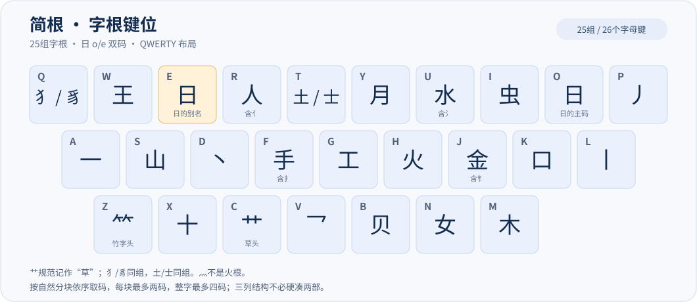

## 制作原因

懒，不想记太多，只想简简单单打字，也不想翻页选字。

## 字根键位

形码方案名为“拼好字”，是键道6（JD6）的魔改版。字根沿用 JD6，但**从 JD6 中删除了贝、加入了火**，毕竟只是用来做辅助形码，不需要顶功也不需要过于注重重码，凑齐七曜更好记。

助记：大多按名称的声母，其余看字形。

| 键 | 单位 | 助记 |
|---|---|---|
| `a` | 一 | a = 1 = 一 |
| `l` | 丨 | l 长得像竖 |
| `p` / `s` | 丿 | 撇 **p**iě；s 与 d 相邻，方便连按 |
| `d` | 丶 | 点 **d**iǎn |
| `v` | 乛 | 折 zhé，自然码 zh 在 v；v 本身也像个折角 |
| `o` / `e` | 日/曰 | o 是圆的，像太阳☀️；e/E 长得像日 |
| `y` | 月 | **y**uè |
| `j` | 金 | **j**īn |
| `m` | 木/朩 | **m**ù |
| `u` | 水/氵/氺 | 三点水，shuǐ，自然码 sh 在 u |
| `h` | 火 | **h**uǒ |
| `t` | 土/士 | **t**ǔ |
| `r` | 人/亻 | **r**én |
| `f` | 手 | 扌是扶手旁，**f**úshǒu；f/F 的形状也像 扌/手 |
| `k` | 口 | **k**ǒu |
| `x` | 十 | 罗马数字 X = 10 = 十；x 也像斜过来的十 |
| `c` | 艹 | 草字头，**c**ǎo |

### 拆字原则
- 只有字根的外形是一眼就能看出来**完全匹配**的才取字根。例如：白不取日，本不取木。
- 整字是字根取根
- 字能分成先后写完的两部分，两部分分别取码，每部分最多两码
- 独体字、穿插字按书写顺序取前四码
- 起首是根取两根（品下部 `口口`、茶下部 `人木`），不是根取两笔（伯右部白 `丿丨`）。根后无根只取一根。

> 穿插字: 外框或骨架在里面的部件之后才写完的字，如`式、国、咸、囚`
> 〇与卍特殊指定取 `乛乛`。

## 使用方式

复制到用户文件夹，运行 `just download` 下载万象语法模型，然后重新部署。

- 使用自然码双拼输入词句，在需要选字的时候输入`;`和形码进行筛选，形码作用于光标前的那个字。输入长句时通过`shift+tab`（左）和`tab`（右）按音节移动光标到需要选字的字后面，再输入形码筛选。输入形码不会影响后续输入。
- 单独输入一个双拼音节时，如果首选不是想要的字，可以只补一个`;`，当前第二候选会升到首位，例如`zl`为“在”、`zl;`为“再”，`ui`为“是”、`ui;`为“时”。继续输入形码字母后仍按正常形码筛选。
- 自动造词：整句组错时改对再上屏，下次直接出现在首位。两种改法都会记住：用 `;形码` 把整句改对后一次上屏（2～7 字）；或分段选字上屏。其余上屏不学习，不改其他候选的顺序；造词库为 `zrm_zc`／`pinyin_zc`，误造的词可在候选上按 `Ctrl+K` 删除。
- 固定候选顺序：默认关闭「上下文调序」，同一编码的字词不会因为上文或反复选用而换位。万象语法模型仍用于整句生成，自动造词也照常工作；新造词仍会加入候选。更换词库或词频时，默认顺序可能改变。想让候选随上文变化，可以手动切到「上下文开」。
- 支持LaTeX符号输入，如`\alpha`可以输入α。
- 当不知道汉字读音的时候，可以用``jj``替代拼音通过形码查找。全拼方案不使用形码。

## 词库与致谢

字表与词库取自[万象拼音](https://github.com/amzxyz/rime-wanxiang) Lite 版（`scripts/dicts/wanxiang`），语法模型取自 [rime-wanxiang-data](https://github.com/amzxyz/rime-wanxiang-data)；`lua/wanxiang` 下的上下文调序、自动造词脚本移植自万象拼音，`auto_phrase.lua` 有本地改动。以上均按 [CC BY 4.0](https://creativecommons.org/licenses/by/4.0/) 使用。

`scripts/generate.py` 按字给万象词条附上「双拼;形码」，生成 `zrm.dict.yaml` 与 `dicts/*.lite.dict.yaml`；全拼方案直接使用万象原始词库。

## 自定义词库

- `scripts/dicts/custom.dict.yaml`：自定义词库，修改后需要运行 `uv run python scripts/generate.py` 进行词库转换，转换后的词库会更新到`dicts/custom.dict.yaml`。
- `scripts/dicts/fix.dict.yaml`：调整已有词条词频的专用词库，修改后同样运行 `uv run python scripts/generate.py`，输出到 `dicts/fix.dict.yaml`；已加入拼音与自然码方案。
- `dicts/custom_phrase.txt`：自定义短词，适用于用缩写编码输入较长的内容，如邮箱、手机号、身份证等。
- 需要提升的自定义词放在 `scripts/dicts/custom.dict.yaml`，按词频参与正常排序。
