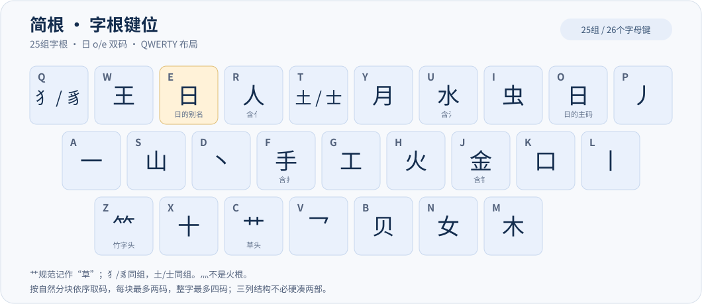
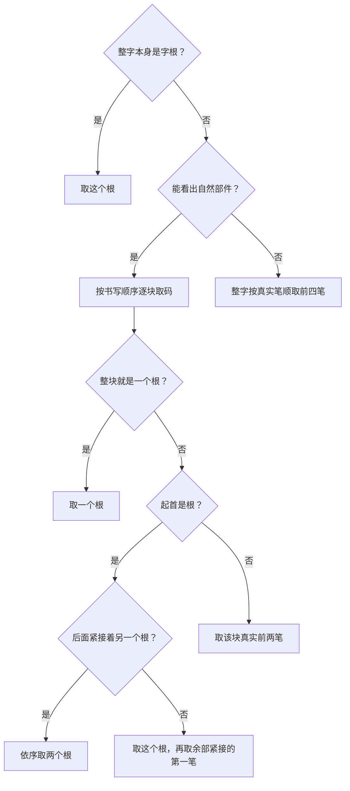

## 制作原因

懒，不想记太多，只想简简单单打字，也不想翻页选字。

## 使用方式

复制到用户文件夹并重新部署。
可选：推荐下载[万象语法模型](https://github.com/amzxyz/RIME-LMDG/releases)。

## 字根键位

形码方案名为“简根”，是键道6的魔改版。

取码到四个就停；不足四码不补。

例如“喆”按`吉吉`取 `士口士口`→`tktk`；“湘”按`氵木目`取 `水木丨`→`uml`；“营”取 `艹丶口口`→`cdkk`；“红”按`纟工`取 `乛乛工`→`vvg`；“笑”按`⺮夭`取 `⺮丿一`→`zpa`。

〇与卍特殊指定取 `乛乛`。

- 使用自然码双拼输入词句，在需要选字的时候输入`;`和形码进行筛选。输入长句时通过`tab`键和`shift+tab`键跳转需要选字的字并通过形码筛选。输入形码不会影响后续输入。
- 支持LaTeX符号输入，如`\alpha`可以输入α。
- 当不知道汉字读音的时候，可以用``jj``替代拼音通过形码查找。
- 形码补全目标为 `8105.dict.yaml` 中8177个不同字，包括原来的“未知”和空白项。本轮已按25根规则复审这8177字，均有码、待补0；不靠猜码维持覆盖率，后续若发现无法确定的错拆仍标待补并保留纯音输入。41448扩展表继续提供拼音，扩展独有字不在本轮逐字补码范围内。

## 自定义词库

- `scripts/dicts/custom.dict.yaml`：自定义词库，修改后需要运行 `uv run python scripts/generate.py` 进行词库转换，转换后的词库会更新到`dicts/custom.dict.yaml`。
- `dicts/custom_phrase.txt`：自定义短词，适用于用缩写编码输入较长的内容，如邮箱、手机号、身份证等。
- 需要提升的自定义词放在 `scripts/dicts/custom.dict.yaml`，按词频参与正常排序。
